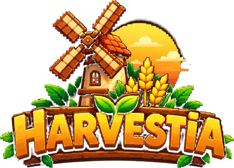

<p align="center"></p>

# Harvestia

**Grow your farm. Trade the markets. Build your empire.**

Harvestia is a browser-based pixel-art farming game with an agricultural economy referenced to real commodity markets and a $HRV token economy (Robinhood Chain first, BNB Chain later).

## Current stage: 6 — Backend

Every farm now lives on the server:

- **Accounts:** the first visit creates a guest account (a random token kept in the browser; only its SHA-256 hash is stored). Wallet sign-in arrives in Stage 8 and will never ask for a seed phrase or private key.
- **Server-authoritative play:** the browser sends actions such as `{ type: 'plant', plot, cell, seed }`, never a new state. The API checks each one against a strict schema, advances the farm's timers by server time, applies the action with the same rules code the browser uses (`shared/`), and stores the result in PostgreSQL inside a row-locked transaction. The browser predicts the result for instant feedback, then adopts the server's answer.
- **Anti-cheat:** per-farm sequence numbers reject replays and duplicates, forged or unknown actions are refused, there's a body size limit, rate limits apply per player and per IP, and action bursts are flagged for review. Every action is written to an audit log.
- **Shared world clock:** day, season and weather follow one schedule (5-minute days, 7-day seasons) computed identically by server and browser. The review panel's weather, time and season buttons are now a visual-only preview with a "Back to live" button.
- **Jobs and multiplayer foundations:** BullMQ on Redis refreshes the leaderboard every minute and cleans up expired sessions nightly. A WebSocket channel shows how many farmers are online and a village activity feed (level-ups, big harvests, new land). It fans out across instances through Redis pub/sub.
- **Offline:** if the server can't be reached the farm keeps running locally and the HUD shows it is offline. Queued actions are retried in order.

### Stage 5 — Core gameplay


The farm is playable with simulated **Farm Coins** (100 coins = $1 reference):

- **Crops:** pick a seed and plant (1 spot, or the whole field with a seed planter), water a row from the can (refill at the well or pond), and harvest a row with the sickle or the whole field with the combine. Crops grow only while their soil is wet. Rain waters everything; the irrigation pump and irrigation channels keep their fields wet. Weather, season and the tractor change growth speed, and storage limits harvests.
- **Livestock:** animals produce eggs, milk, wool and truffles only while fed. Feed lasts several cycles; unfed animals lose health. Collect products by clicking the animal (a bubble shows when ready) or from the Livestock window. Buy more within pen space.
- **Machinery:** buy machines and level them up (can capacity, pump coverage, tractor growth bonus, harvester bonus, storage).
- **Farm upgrades:** unlock the expansion plots, enrich a field with fertile soil (+1 per plant) or dig an irrigation channel, and add coops, shelters, barns and silos for more space.
- **Progress:** XP and levels unlock crops (coffee at 5, cocoa at 6). Rotating tasks pay coins and XP. Selling in the inventory uses fixed store prices.
- **Saving:** on the server since Stage 6. Timers keep running while you are away and catch up on return; you can reset from the profile.

The rules live in `shared/sim/` as pure, deterministic functions (with unit tests), shared by the browser and the server.

### Stage 4 — Game UI

Pixel-art game windows over the live world. Open them from the left menu, the toolbar, keyboard shortcuts or the inspector's action button:

| Window | Shortcut | Contents |
|---|---|---|
| Inventory | I | Storage grid with category tabs, capacity, item details, quality stars and value |
| Marketplace | B | General Store (seeds, feed, livestock, buildings, land, machinery) priced in $HRV with USD reference ≤ $15; purchase review with quote expiry and the 50% burn / 50% farmer-treasury split; player listings preview |
| Commodity Exchange | E | Market list, price chart (7/30/60 days), in-game price breakdown with bounded moves, order ticket with fee, order book, recent trades |
| Profile | P | Farm, level and XP, stats, achievements |
| My Farm | F | Field stages from the live world, today's weather and tasks |
| Equipment | M | Machines with level, condition, effects and upgrade cost |
| Livestock | L | Herd with health, happiness, feeding and production timers |
| Wallet & Vault | V | Wallet vs Game Vault balances (placeholders), 3% deposit / 5% withdrawal fees, burn and treasury totals |

Farm controls: the toolbar strip shows a seed picker (Plant), watering-can level (Water), ready fields (Harvest), and building/upgrade shortcuts. All prices, balances and market figures are clearly labelled demo or simulated values; actions show the stage that enables them.

### Stage 3 — Animations and visual polish

The world is alive:

- **Day and night:** a sky-tinted lighting pass from dawn to dusk to night. Windows switch on one by one and street lamps glow.
- **Weather:** sunny, cloudy, rain, storm (with lightning) and drought, with smooth transitions. Rain splashes on the ground and ripples on water; drought parches the land and stirs up dust.
- **Seasons:** spring, summer, autumn (orange, red and gold trees, falling leaves) and winter (snow cover, snowy trees, snowfall, iced shorelines). Grass and trees are repainted from season palettes.
- **Wind:** tree canopies sway, and gusts roll across the crop fields; both strengthen in storms.
- **Crops:** growth-stage sprites, a demo plot that loops plant → sprout → grow → harvest with pop and sparkle effects, and glints on ripe crops.
- **Water:** flowing sparkles, lapping shoreline foam, ripples, jumping fish and duck wakes.
- **Wildlife:** grazing cows and sheep, butterflies by day, fireflies at night, and bird flocks.
- **Environment panel:** set the time, clock speed, weather and season to review every look. The top bar shows the live season, day, weather, temperature and time.

Stage 2 foundations: a Next.js + Phaser 3 + TypeScript game:

- **World:** six zones on a 1024×640 art-pixel map with a 32×32 logical terrain grid (press **G** to show it).
- **Rendering:** the approved Stage 1 sprite library is recorded into packed texture atlases. Every object is a depth-sorted Phaser image, so characters walk behind trees and buildings correctly.
- **Animation:** animals, farmers, the tractor and the windmill blades play generated sprite-sheet animations.
- **Camera:** drag, WASD/arrow keys, mouse-wheel zoom toward the cursor, +/−, a live minimap, and zone navigation from the left menu.
- **Selection:**
  - buildings, fields and individual planting cells
  - animals and villagers
  - machinery
  - any terrain tile

  Hovering outlines an object; clicking selects it and opens the inspector.
- **React HUD** (Zustand state): profile, wallet and vault placeholders, a commodity board (clearly **simulated** demo values), a toolbar (keys 1–6), the inspector and view controls.

The Stage 1 concept and art-direction sheet stay available at `/concept/index.html`.

| Path | Purpose |
|---|---|
| `src/game/art/sprites.js` | Procedural pixel-art sprite library (approved in Stage 1) |
| `src/game/world/` | Geometry, terrain generation, world layout and hotspots |
| `src/game/render/atlas.ts` | Draw-call recorder, atlas packer, Graphics adapter |
| `src/game/scenes/WorldScene.ts` | Phaser scene: rendering, actors, camera, selection |
| `src/game/env/` | Clock, sky colours, weather looks, season palettes |
| `src/game/systems/` | Lighting, weather, water, wildlife, crop and particle systems |
| `src/store/game.ts` | Shared state between Phaser and the HUD |
| `src/components/hud/` | React HUD |
| `src/components/panels/`, `src/components/ui/` | Game windows and the pixel UI kit |
| `src/game/data/` | Item catalog, economy rules, simulated market, demo data |
| `shared/` | Rules, actions, catalog, world clock and geometry shared by client and server |
| `src/lib/sync.ts` | Client prediction, ordered action queue and server reconciliation |
| `server/` | API, Prisma schema and migrations, jobs, live channel |

## Architecture

| Part | Where | Path |
|---|---|---|
| Frontend: Next.js + Phaser game client | Vercel, https://harvestia-one.vercel.app | repo root |
| Backend API: Fastify + TypeScript | Railway, https://harvestia-api.up.railway.app | `server/` |
| Database: PostgreSQL (Prisma) | Railway | `server/prisma/` |
| Queue, cache, pub/sub: Redis (BullMQ) | Railway | `server/src/jobs.ts`, `server/src/live.ts` |

API routes: `GET /health`, `GET /v1/status`, `GET /v1/world`, `POST /v1/auth/guest`, `GET /v1/me`, `GET /v1/farm`, `POST /v1/farm/actions`, `POST /v1/farm/reset`, `GET /v1/leaderboard`, `GET /v1/farms/:id`, and the WebSocket `/v1/live`. CORS only allows the Vercel site, its preview deployments and local dev.

## Develop

```bash
npm install && npm --prefix server install
npm run dev        # frontend on http://localhost:5180
npm test           # game rules tests
npm --prefix server run db:local   # throwaway PostgreSQL on :54331 (no Docker needed)
npm run api:dev    # API on http://127.0.0.1:4000 (set DATABASE_URL; without it the API uses an in-memory store)
npm run api:test   # API tests
```

Copy `.env.example` to `.env.local` and point `NEXT_PUBLIC_API_URL` at `http://127.0.0.1:4000` to use a local API.

## Deploy

- **Vercel** builds the Next.js app from the repo root; `server/` is excluded via `.vercelignore`.
- **Railway** builds the API from `server/Dockerfile` with the repo root as context (so `shared/` is bundled in), runs `prisma migrate deploy` on start, and is health-checked on `/health`. It redeploys when `server/` or `shared/` change. `DATABASE_URL` and `REDIS_URL` reference the project's Postgres and Redis services.

## Roadmap

Development is stage-gated; each stage ships only after explicit approval.

1. Visual concept ✓
2. Playable world ✓
3. Animation polish ✓
4. Game UI ✓
5. Core gameplay ✓
6. Backend ← current
7. Commodity economy
8. Blockchain
9. Buybacks and rewards
10. Multiplayer and competitions
11. Production readiness
